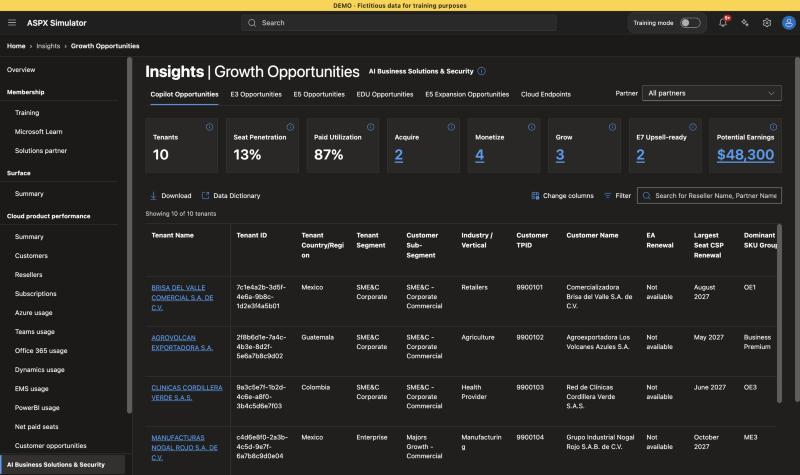

# ASPX Simulator

A static, client-side training replica of the **Copilot Opportunities** tab of
Partner Center › Insights › Growth Opportunities (AI Business Solutions & Security).
Use it to teach Microsoft partners how to read ASPX **without exposing real customer data**.

> **DEMO · Fictitious data for training purposes.** Every company, partner, GUID, TPID and
> MPN ID in this repo is invented. No Microsoft logos are used.



## What's included

| Area | Details |
| --- | --- |
| Layout | Top bar, breadcrumb, collapsible 265px sidebar, page header, pivot tabs, partner context selector |
| KPI tiles | Tenants, Seat Penetration, Paid Utilization, Acquire, Monetize, Grow, E7 Upsell-ready, Potential Earnings (the last 5 filter the table) |
| Charts | Copilot Tenant Penetration, Copilot Opportunities, Free-Paid Signals by Tenant, Copilot Usage by License, MCI Potential Earnings — click a segment/bar/line to filter the table |
| Table | 54 default + 36 hidden columns, sticky first column, sort, Change columns (show/hide, reorder, Download-only), Filter drawer, search, CSV/XLSX download |
| Flyouts | Tenant detail, Copilot Opportunity details, E7 Opportunity, All Copilot MAU, All Agents MAU, MTD Credits Consumed, Weekly Consumption, Admin Settings Recommendations |
| Training mode | Numbered highlights with definitions + Spanish training notes, 10-step guided tour, 5 Playbooks, “What to do with this tenant” |

All labels, definitions and flyout text are in **English**, taken from the Microsoft Learn
data dictionary *Copilot growth opportunities data in AI Business Solutions & Security Insights*.
The only Spanish text is the optional training content (technical terms stay in English).

## Run locally

Requires Node.js 20+.

```bash
npm install
npm run dev        # http://localhost:5173
npm test           # Vitest: formulas, scenario rule, dataset totals
npm run build      # production build in dist/
```

## Edit the dataset

- `src/data/tenants.ts` — the 10 hand-crafted tenants (typed constant, bundled, no fetch).
  Only *source* signals live here: seats, PAU, MAU, propensity, renewals, credits, admin settings, etc.
- `src/lib/metrics.ts` — every derived field is computed here, never hard-coded:
  - Copilot Utilization = min(MAU / PAU, 100%)
  - Copilot Seats Whitespace = Eligible − PAU
  - Free to Paid Whitespace = Unlicensed MAU / (Unlicensed MAU + PAU)
  - Free Chat Penetration = Free MAU / Eligible
  - All Copilot MAU = Licensed + Unlicensed
  - Scenario: propensity Low → Not targeted; paid penetration > 5% → Grow; Chat MAU penetration > 5% → Monetize; otherwise Acquire
- `src/lib/columns.ts` — column order, groups, formats and which flyout each link opens.
- `src/lib/dictionary.ts` — official definitions (`DEFS`) and Spanish training notes (`TRAINING_NOTES`).
- `src/lib/filters.ts` — Filter drawer facets and Playbooks.
- `src/lib/advice.ts` — rules for “What to do with this tenant”.

After editing, run `npm test`. The tests check the expected totals
(Tenants 10 · Acquire 2 · Monetize 4 · Grow 3 · Not targeted 1 · E7 Upsell-ready 2),
so update `src/lib/metrics.test.ts` if you change the teaching cases on purpose.

### Teaching cases

| # | Scenario | Story |
| --- | --- | --- |
| 1 | Acquire | SME&C, OE1, no paid seats, Free Chat 2%, Offer Trial |
| 2 | Acquire | SME&C, Business Premium, Offer Trial - High Propensity, MCI eligible |
| 3 | Monetize | SME&C, OE3, Free Chat 18%, usage limits + license requests |
| 4 | Monetize | Enterprise, ME3, heavy agents, PAYGO credits at 94% of the Monthly Credit Limit |
| 5 | Monetize | SME&C, OE1+EMS / OE1 Plus, trial “Drive Adoption – Churn Risk”, 9 days remaining |
| 6 | Grow | Enterprise, ME5, Adoption Status Healthy, Largest Seat CSP Renewal in 4 months |
| 7 | Grow | SME&C, ME3, Failure to Adopt, 3 Admin Settings need attention |
| 8 | Grow + E7 | Enterprise, ME5, “ME5 with H/M agent intensity”, Frontier Enabled, Cowork MAU |
| 9 | Monetize + E7 | Enterprise, ME3, “ME3 with H/M agent intensity”, Data Security Maturity Limited-Unhealthy |
| 10 | Not targeted | SME&C, Business Basic, Low propensity, Data Security Maturity Minimal |

## Deploy to GitHub Pages

1. Create a GitHub repository (for example `aspx-simulator`) and push this folder to the `main` branch.
2. In the repository go to **Settings › Pages** and set **Source: GitHub Actions**.
3. Every push to `main` runs `.github/workflows/deploy.yml`: install → test → build → deploy.
4. The site is published at `https://<your-user>.github.io/<repo-name>/`.

The workflow sets `BASE_PATH=/<repo-name>/`, which `vite.config.ts` uses as Vite's `base`.
The app uses `HashRouter` (`#/growth/copilot`), so no server rewrites are needed on Pages.
To build for another sub-path locally: `BASE_PATH=/my-path/ npm run build`.

## Tech stack

React 18 · Vite · TypeScript · Fluent UI React v9 (`webDarkTheme`, light toggle in Settings) ·
Apache ECharts (`echarts-for-react`) · TanStack Table v8 · SheetJS (CSV/XLSX) · Zustand ·
react-joyride · Vitest.

## Accessibility

- Sortable headers, links, flyouts and drawers are keyboard reachable; flyouts close with `Esc`.
- Pivot tabs support arrow-key navigation.
- Every chart has hidden “Filter table: …” buttons so click-to-filter also works from the keyboard and with screen readers.
- Text and link colors meet WCAG AA on the dark and light themes.
- Designed for 1280px+; the sidebar collapses automatically below 1280px.
